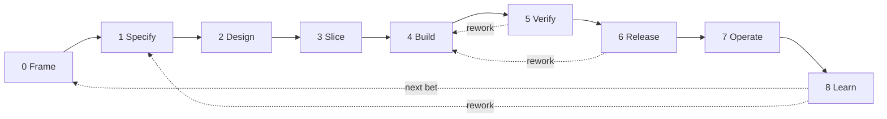

# The Software Factory

A language-agnostic operating model for turning a problem into a running, observable
product — and keeping it correct while it changes.

Designed for **one human plus AI agents**. It scales to a small team without redesign,
because coordination happens through artifacts and gates rather than meetings.

---

## 1. What "factory" means here

A factory is not a pipeline of tools. It is a set of **obligations**, the **evidence** that
satisfies them, and a fixed set of **stations** where that evidence is produced.

| Layer | Contains | Changes when |
| --- | --- | --- |
| Obligations | What must be true before work advances | Rarely, deliberately |
| Gates | How an obligation is demonstrated | When a failure escapes |
| Adapters | Which tool demonstrates it for this stack | Whenever the stack changes |

**Independence rule:** no language, framework, tool, or methodology appears above the
adapter layer. If a rule only makes sense for one stack, it is an adapter rule, not a
factory rule. The same applies to methods: TDD, BDD, formal specification, or a careful
manual pass are all acceptable ways to satisfy a gate, as long as the evidence exists.

## 2. The flow

Stations are **concerns, not calendar phases**. A small change may satisfy S1–S5 in one
afternoon; the questions are still answered in order, and each leaves a record.

Every unit of work is a **slice**: the smallest change that produces observable behavior.
A slice's state is the last gate it passed.

## 3. The artifact chain

Each artifact is the input to the next station and the evidence for its gate.

| # | Artifact | Station | Answers |
| --- | --- | --- | --- |
| A1 | Problem brief | S0 | Why this, for whom, how we will know it worked |
| A2 | Spec | S1 | What must be true, how it is verified, what is excluded |
| A3 | Decision records | S2 | Why the design is this way, what was rejected |
| A4 | Slice plan | S3 | What ships next, its blast radius, how to undo it |
| A5 | Evidence pack | S5 | Proof the change does what the spec says |
| A6 | Release record | S6 | What shipped, where, how to roll back |
| A7 | Runbook | S7 | How to tell it is healthy and what to do when it is not |
| A8 | Learning review | S8 | Whether the outcome happened, and what changes next |

Templates live in [`../../templates`](../../templates).

## 4. Risk tiers

Ceremony is proportional to blast radius. The tier is declared in A4 and enforced at G3;
touching a protected path escalates it automatically.

| Tier | Examples | Ceremony |
| --- | --- | --- |
| T0 | Docs, comments, formatting, test-only changes | Fast gates |
| T1 | Local behavior, reversible, no contract or data change | Standard gates |
| T2 | Contracts, schema, auth, shared components | All gates, staged release |
| T3 | Data deletion, money, PII, security model, breaking public API, infrastructure | All gates, human sign-off, rollback rehearsal |

The tier may only be lowered with a written reason in the slice plan. When in doubt,
choose the higher tier: the cost is minutes, the cost of being wrong is days.

## 5. Documents

| Doc | Use |
| --- | --- |
| [01-principles](01-principles.md) | The invariants. Read once. |
| [02-stations](02-stations.md) | What each station owes, and who decides. |
| [03-gates](03-gates.md) | The gate catalog and enforcement classes. |
| [04-stack-binding](04-stack-binding.md) | How to bind a stack without changing the factory. |
| [05-agents](05-agents.md) | Autonomy levels, context packs, review protocol. |
| [06-metrics](06-metrics.md) | Scorecard and anti-gaming rules. |
| [07-adoption](07-adoption.md) | Phased rollout and how to change the factory itself. |
| [08-artifacts](08-artifacts.md) | Where artifacts live, how they are versioned, and the waiver register. |

## 6. Quickstart

1. Copy the templates you need. Delete sections you cannot answer yet and record why —
   an unanswered question is information; a guessed answer is a defect.
2. Declare the risk tier and the protected paths the change touches.
3. Fill A1 → A2 → A4 before writing code. Write A3 only when a decision is hard to reverse.
4. Implement the slice with its tests. Build A5 from real command output, not from memory.
5. Pass G4–G6 and store A6 with the artifact version that shipped.
6. At the agreed horizon, write A8 and feed the result into the next A1.

If a gate is not wired yet, mark it `manual` in the evidence pack with an owner and an
expiry date. Never mark it `passed` without evidence.

## 7. What this model refuses to do

- It does not prescribe a language, framework, architecture style, or methodology.
- It does not require a full document for every commit; tiers exist for that reason.
- It does not treat test coverage, velocity, or line count as goals.
- It does not let an agent approve its own high-risk work.
- It does not add a gate without a failure that motivated it.
